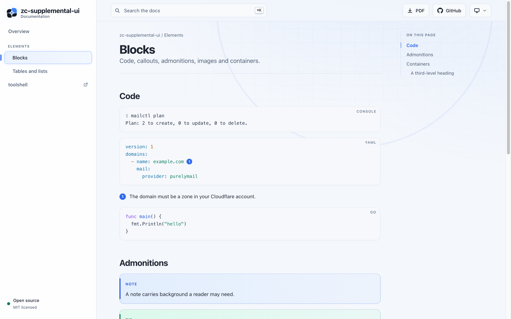

# zc-supplemental-ui

The ZoolCoder look for [Antora](https://antora.org) documentation sites, and
a matching [asciidoctor-pdf](https://docs.asciidoctor.org/pdf-converter/latest/)
theme for the PDF of the same docs. It carries the design of
[toolshell](https://github.com/zoolcoder/toolshell), so an admin tool and its
docs look like one product.

<picture>
  <source media="(prefers-color-scheme: dark)" srcset=".github/preview-dark.png">
  
</picture>

## What you get

- A sidebar that becomes a drawer on phones, a glass header with search, and
  light, dark and auto themes.
- Search for the [Antora Lunr extension](https://gitlab.com/antora/antora-lunr-extension),
  opened with <kbd>Ctrl</kbd>/<kbd>⌘</kbd> <kbd>K</kbd> or <kbd>/</kbd>.
- A table of contents that follows the reader, breadcrumbs, previous and next
  cards, and an "Edit this page" link.
- Highlighted code with a copy button. In a `console` block it copies only
  the commands, without their `$` prompts.
- Every Asciidoctor block styled: admonitions, tables, callouts, definition
  lists, examples, sidebars, quotes and images.
- Keyboard shortcuts. Press <kbd>?</kbd> on any page for the list.
- A PDF button, and a theme that gives the PDF the same mark and colours.
- No external requests and no tracking. Everything is served by your site.

## Use it

Point the playbook at a release:

```yaml
ui:
  bundle:
    url: https://github.com/zoolcoder/zc-supplemental-ui/releases/download/v0.1.0/ui-bundle.zip
```

Then set the attributes that switch on the parts you want:

```yaml
asciidoc:
  attributes:
    page-zc-repo: https://github.com/you/project   # GitHub button, footer links
    page-zc-pdf: project/_exports/index.pdf         # PDF button, path from the site root
    page-zc-site: https://example.com/             # website link in the menu and footer
    page-zc-site-name: example.com
    page-zc-owner: Your name                        # footer
    page-zc-tagline: Documentation                  # under the product name
    page-zc-license: MIT licensed                   # footer and sidebar
    page-zc-og-image: https://example.com/card.png  # link previews
```

For search, add `@antora/lunr-extension` to `antora.extensions`.

### The PDF

Use [Antora Assembler](https://docs.antora.org/assembler/latest/) with
asciidoctor-pdf, and give it the theme from the same release:

```sh
curl -fsSL -o zc-pdf-theme.zip \
  https://github.com/zoolcoder/zc-supplemental-ui/releases/download/v0.1.0/zc-pdf-theme.zip
unzip -o zc-pdf-theme.zip -d build/pdf-theme
```

```yaml
# antora-assembler.yml, next to the playbook
root_level: 0
build:
  command: bundle exec asciidoctor-pdf -a pdf-themesdir=build/pdf-theme -a pdf-theme=zc
  publish: true
asciidoc:
  attributes:
    doctype: book
    toc: ''
    title-page: ''
    source-highlighter: rouge
    zc-owner: Your name   # shown in the page footer
```

The command runs in the playbook's folder, so `pdf-themesdir` is relative to
it. The PDF lands at `<component>/_exports/index.pdf`, which is the path to
put in `page-zc-pdf`. The `preview/` folder of this repo is a working example.

On Ruby 3.5 or later, add `logger`, `bigdecimal`, `base64`, `ostruct` and
`csv` to the Gemfile next to `asciidoctor-pdf`: they are no longer default
gems, and its dependencies still load them.

## Develop

See [CONTRIBUTING.md](CONTRIBUTING.md). In short: `npm ci`, then
`npm run preview`, and open `build/preview`.

## Licence

[MIT](LICENSE). highlight.js, vendored into the bundle, is under its own
BSD-3-Clause licence, included as `js/vendor/highlight.LICENSE.txt`.
